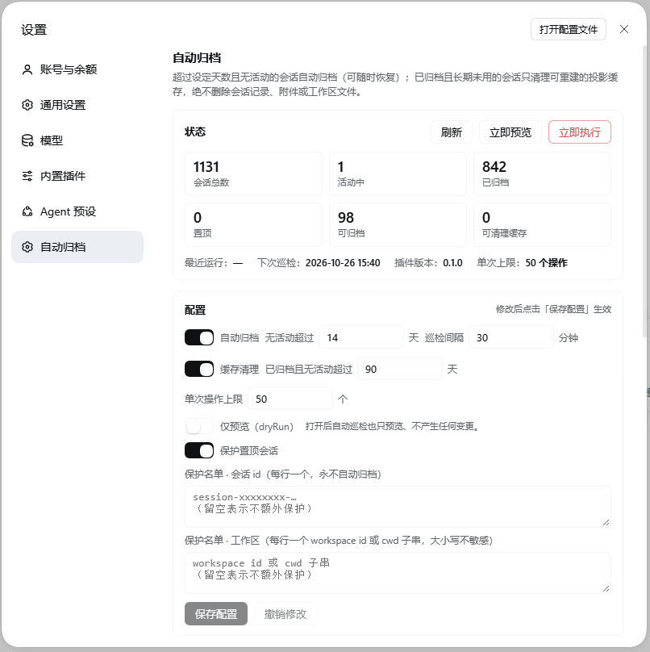

# dsh-auto-archive

> A DSH plugin that automatically archives idle conversations and clears the expired projection cache of archived sessions — without deleting transcripts, attachments, workspace files or anything a conversation produced.

> 给 DeepSeek Harness（桌面版 / Web）用的本地插件：闲置会话按天自动归档，已归档会话的超期「对话缓存」自动清理，**不删除会话记录、附件或任何对话产出**。



## What it does / 它做什么

| Capability | Default | Behaviour |
| --- | --- | --- |
| Auto-archive / 自动归档 | idle **14 days** | Calls DSH's official `workspaceRegistry.archiveSession()`; archived sessions stay restorable from the archived list. |
| Cache cleanup / 缓存清理 | archived and idle **90 days** (~3 months) | Deletes only DSH's derived projection cache (`~/.dsh/storages/session_projcache/sessions/<id>.json`, rebuilt on demand). |
| Scheduled check / 巡检 | every **30 minutes** | Silent background check; the settings panel can preview or run immediately. |
| Protection / 保护 | pinned sessions | Optional extra allow-list by session id, workspace id or cwd fragment. |
| Audit / 审计 | last 30 runs | Per-run archive/cleanup details; restoring an archived session is one click. |

## Safety boundary / 安全边界

The plugin never deletes:

- session transcripts (`session.v4.jsonl.zstd` / session directories);
- attachments (`~/.dsh/attachments`), spill files, workspace or project files;
- results produced by a conversation — archiving only adds/removes ids in DSH's archived set, and the content stays untouched.

Its only two writes are:

1. **Archive state** — adding/removing session ids in DSH's `archivedSessionIds` through the official registry API (reversible).
2. **Projection cache** — deleting `~/.dsh/storages/session_projcache/sessions/<id>.json`, a cache DSH rebuilds on demand.

Active sessions are always skipped (the plugin never passes `stopActivity`), so a running turn, job or subagent is never interrupted.

## Install / 安装

Install into a DSH profile (the desktop profile is managed by the Electron app, so use the CLI):

```powershell
dsh plugin --profile desktop add github:elk-9527/dsh-auto-archive
```

Or from a local checkout:

```powershell
dsh plugin --profile desktop add "file:D:/path/to/dsh-auto-archive"
```

Then **fully quit and reopen DSH** (host plugins load at startup). Open the panel via **bottom-left avatar → Settings → 自动归档**; it appears next to General / Built-in plugins.

Uninstall:

```powershell
dsh plugin --profile desktop remove dsh-auto-archive
```

## Configuration / 配置

Stored at `~/.dsh/auto-archive/config.json` (created automatically; editable from the panel):

```json
{
  "version": 1,
  "autoArchive": { "enabled": true, "idleDays": 14, "checkIntervalMinutes": 30 },
  "cacheCleanup": { "enabled": true, "unusedDays": 90 },
  "protect": { "pinnedSessions": true, "sessionIds": [], "workspaces": [] },
  "limits": { "maxOperationsPerRun": 50 },
  "dryRun": false
}
```

- `idleDays` — a session whose last activity is older than this is archived. Last activity = max(transcript mtime, `createdAt`).
- `unusedDays` — an archived session idle longer than this has its projection cache removed.
- `protect.workspaces` — workspace id or a case-insensitive cwd fragment; matching workspaces are never archived.
- `dryRun: true` — every automatic run becomes a preview.
- `limits.maxOperationsPerRun` — caps one run, so a first launch cannot sweep the whole history at once.
- Run state lives in `~/.dsh/auto-archive/state.json` (atomic writes, last 30 runs).

## HTTP API / 本机回环 API

Prefix `/dsh-auto-archive` (loopback Host only; anything else gets `403`):

| Method | Path | Purpose |
| --- | --- | --- |
| GET | `/dsh-auto-archive/api/state` | Config, last/next run, counts |
| GET | `/dsh-auto-archive/api/sessions?limit=200` | Session inventory with idle days and eligibility |
| GET | `/dsh-auto-archive/api/history` | Last 30 runs |
| POST | `/dsh-auto-archive/api/config` | Deep-merge and save config |
| POST | `/dsh-auto-archive/api/run` | `{"dryRun":true}` preview / `{"dryRun":false}` execute |
| POST | `/dsh-auto-archive/api/restore` | `{"sessionIds":["..."]}` unarchive |

## Development / 开发

```powershell
npm test              # node --test "test/*.test.mjs" "test-client/*.test.mjs"
npm run test:e2e      # fake-host end-to-end suite (temp DSH_HOME, real node:http)
```

The host half interacts with DSH only through `ctx` services (`webServer`, `sessionPersistence`, `sessions`, `workspaceRegistry`, `sessionProjectionCache`); the client half is a hand-written `window.__ModuleLoader__.load({...})` bundle with no build step. No third-party dependencies. Node ≥22.

```
index.js            # host entry
lib/config.js       # config schema / load / atomic write
lib/state.js        # run state and history
lib/sessions.js     # inventory, last-activity, classification
lib/run.js          # archive + cache cleanup (dry-run has no side effects)
lib/api.js          # HTTP API + loopback guard
lib/scheduler.js    # periodic checks, single-flight
client.js           # settings panel (ModuleLoader bundle, no build)
cordis.patch.yml    # profile patch layer
test/ test-client/  # node --test suites
e2e/                # fake-host integration suite
docs/kernel-api.md  # verified DSH kernel API reference
```

## Known limits / 已知限制

- Cache cleanup targets **archived** sessions only, so the active list is never touched.
- "Conversation cache" means DSH's projection cache; transcripts and attachments are never deleted by design, so they keep their disk usage.
- Archiving obeys DSH's own activity check; a session another plugin considers active is skipped, never force-stopped.
- The host half loads at startup: restart DSH after changing code.

## Verified scope / 已验证范围

- **Settings panel** — opened in a real Edge (headless CDP) session at `bottom-left avatar → Settings → 自动归档`; panel renders status cards, config form, inventory and history with no console errors (see screenshot above).
- **Host API** — exercised on a scratch profile against real data: state/session inventory, dry-run (98 candidates → capped at 50), live archive of one session (`archivedSessionIds` +1), restore, cache-cleanup candidate counting.
- **Safety** — only registry archive/unarchive happened against real data; the archive set was restored to its pre-test baseline, and no transcript, attachment or workspace file was removed.
- **Tests** — 148 unit/client tests plus the fake-host e2e suite pass.
